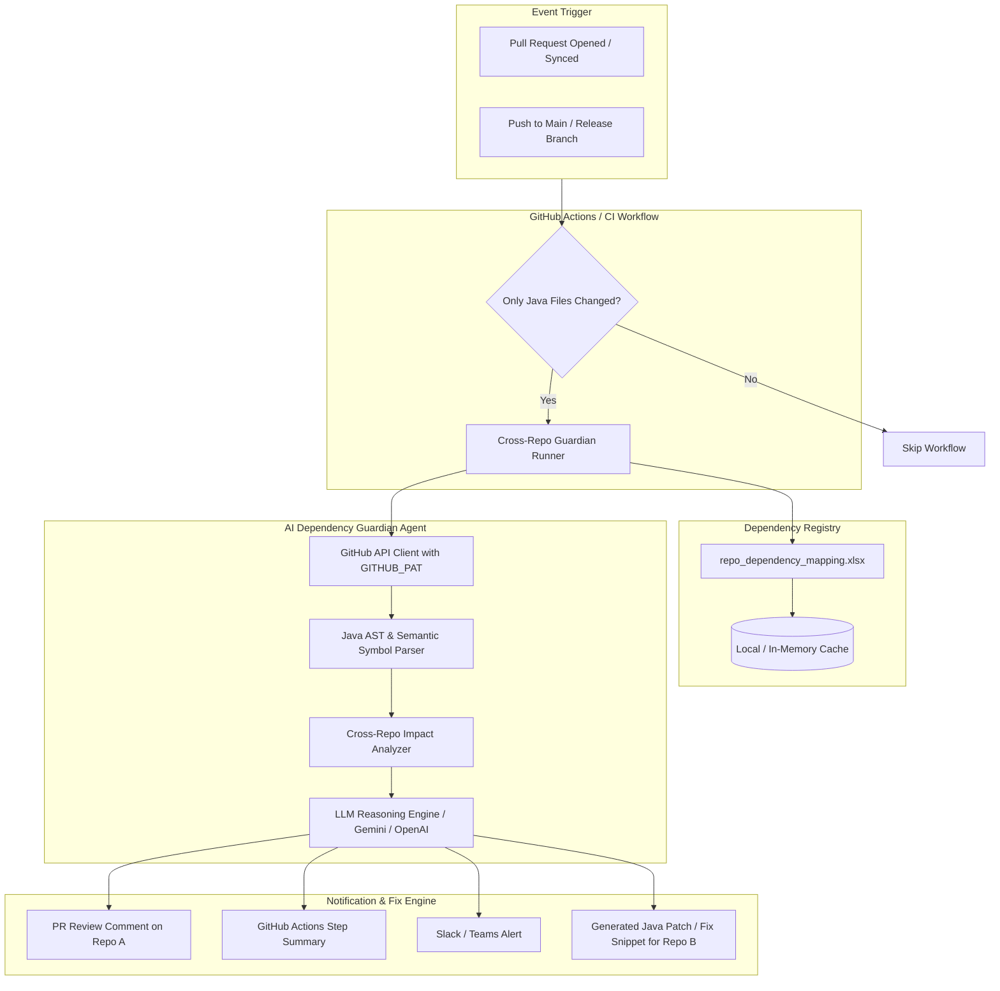
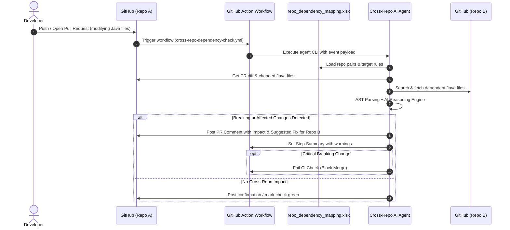

# Cross-Repository Java Dependency Guardian: Architecture Blueprint

## 1. Executive Summary & Problem Definition

In modern distributed microservice and multi-repo architectures, services communicate via shared contracts (REST APIs, DTOs, Kafka/JMS event payloads, gRPC schemas, or client SDKs). 

### The Production Failure Mode
- **Developer Action**: A developer modifies a Java class in **Repository A** (e.g., renames a field in `OrderDTO.java`, removes a method parameter in a shared service, or alters a `@PostMapping` route).
- **The Blind Spot**: The developer is unaware that **Repository B** (e.g., `payment-service` or `notification-service`) directly consumes this model or interface.
- **Outcome**: The PR in Repo A passes local unit tests and merges. Upon deployment to production or staging, Repo B suffers `NoSuchMethodError`, `JsonMappingException`, `NullPointerException`, or HTTP 400 Bad Request, causing production outages.

---

## 2. High-Level System Architecture

---

## 3. Core Components

### 3.1 Repository Dependency Registry (`repo_dependency_mapping.xlsx`)
An Excel-driven configuration matrix maintained by engineering leads or architects. It maps:
- `Source_Repo` (e.g. `acme-corp/order-service`)
- `Target_Repo` (e.g. `acme-corp/billing-service`)
- `Relationship_Type` (`REST_CONSUMER`, `EVENT_SUBSCRIBER`, `SHARED_DTO`, `SDK_CLIENT`)
- `Source_Path_Pattern` (e.g. `src/**/dto/**/*.java`, `src/**/controller/**/*.java`)
- `Target_Path_Pattern` (e.g. `src/**/client/**/*.java`, `src/**/events/**/*.java`)
- `Notify_Channel` (e.g. PR Comment, Webhook, Email)
- `Severity_Threshold` (`CRITICAL`, `WARNING`, `ALL`)

### 3.2 Java Semantic & AST Extraction (`src/java_parser.py`)
Analyzes changed `.java` files from git diffs without requiring full Maven/Gradle compilation:
- **Class / Interface declarations**: Name, inheritance, implemented interfaces.
- **Field signatures**: Name, type, visibility, Jackson annotations (`@JsonProperty`, `@JsonIgnore`).
- **Method signatures**: Parameter list, return type, exceptions, `@Override`.
- **Spring / JAX-RS annotations**: `@RestController`, `@GetMapping`, `@PostMapping`, `@PathVariable`, `@RequestBody`.
- **Event / Messaging annotations**: `@KafkaListener`, `@RabbitListener`.

### 3.3 GitHub Cross-Repo Client (`src/github_client.py`)
- Uses the `GITHUB_PAT` token to securely query GitHub REST API.
- Fetches PR commit diffs or push commit ranges from the source repository.
- Scans and downloads candidate dependent Java files from the target repository on demand.
- Publishes automated PR reviews or markdown comments on the pull request.

### 3.4 AI Impact Analyzer Agent (`src/analyzer_agent.py`)
Uses multi-stage reasoning to evaluate cross-repo impacts:
1. **Delta Isolation**: Compares the old vs new versions of the modified Java files in Repo A.
2. **Target Matching**: Identifies which files in Repo B reference or duplicate the modified structures.
3. **Semantic Conflict Evaluation**:
   - Field removals, renames, type changes.
   - Endpoint URL changes, HTTP method changes, header/parameter modifications.
   - Missing required fields in payloads.
4. **Fix Generation**: Produces a suggested patch for Repo B with explanation.

### 3.5 Fallback & Offline Heuristic Engine
Ensures zero-dependency operation: if an external LLM API key is not configured, the agent executes static AST & heuristic contract diffing (field diff, method diff, regex matching), ensuring reliable CI execution in all environments.

---

## 4. Sequence of Operation

---

## 5. Security & Governance

- **Token Safety**: `GITHUB_PAT` is read strictly from GitHub Action Secrets or `.env` and is masked in logs.
- **Least Privilege**: The PAT requires read access to dependent repos and write access to PR comments in the triggering repo.
- **Air-Gapped / Privacy Friendly**: The architecture supports local LLMs (Ollama/vLLM), Azure OpenAI private endpoints, or static AST fallback without transmitting code outside the enterprise boundary.
