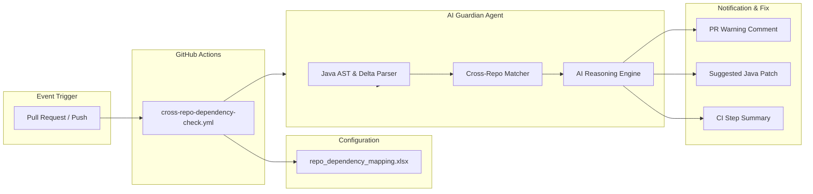

# 🛡️ Cross-Repository Java Dependency Guardian

> **AI Architect Solution**: Automated cross-repository contract dependency analysis to prevent silent breaking changes, runtime errors, and production outages in multi-repo microservices architectures.

---

## 📌 Problem & Context
In distributed multi-repository architectures, service teams frequently modify shared Java contracts (DTOs, REST APIs, Kafka payloads, gRPC interfaces, or shared clients). When a developer updates a Java file in **Repository A** (e.g. `order-service`) and forgets to update the affected files in **Repository B** (e.g. `payment-service`), production outages occur due to:
- `NoSuchMethodError` / missing getters & setters
- `JsonMappingException` / Jackson payload unmarshalling failure
- Type mutation errors (`UUID` vs `Long`, `BigDecimal` vs `Double`)
- Endpoint route mutations (`404 Not Found` or `400 Bad Request`)

---

## 🏛️ System Architecture



---

## 📊 1. Repository Dependency Matrix (`repo_dependency_mapping.xlsx`)

The repository mapping is maintained in [repo_dependency_mapping.xlsx](repo_dependency_mapping.xlsx).

| Column | Description | Example |
| :--- | :--- | :--- |
| `Pair_ID` | Unique mapping rule identifier | `DEP-001` |
| `Source_Repo` | Trigger repository | `sample-org/order-service` |
| `Source_Branch` | Target branch | `main` |
| `Source_File_Pattern` | Glob patterns of watched Java files | `**/dto/**/*.java, **/api/**/*.java` |
| `Target_Repo` | Dependent repository | `sample-org/payment-service` |
| `Target_Branch` | Target repository branch | `main` |
| `Target_File_Pattern` | Target candidate files | `**/client/**/*.java, **/consumer/**/*.java` |
| `Dependency_Type` | Nature of coupling | `REST_API_CONSUMER`, `EVENT_PAYLOAD_SCHEMA`, `SHARED_DTO` |
| `Severity_Level` | Alert severity | `CRITICAL`, `HIGH`, `MEDIUM` |
| `Notification_Channel` | Notification destination | `PR_COMMENT`, `SLACK`, `BOTH` |
| `Auto_Block_PR` | Gatekeeper merge block | `TRUE` / `FALSE` |
| `Owner_Team` | Responsible engineering group | `Checkout-Team` |
| `Description` | Contextual contract explanation | Details on what breaks |

To regenerate or modify the Excel schema programmatically, run:
```bash
python scripts/create_dependency_excel.py
```

---

## 🤖 2. Core Agent Engine with GitHub Repo Analyzer Integration

The agent integrates remote **GitHub Repository Architecture Analysis** with **deterministic Java AST parsing** and **LLM semantic reasoning** (Gemini / OpenAI / Copilot):
1. **Repository Architecture Discovery** ([src/repo_analyzer.py](src/repo_analyzer.py)):
   - Analyzes source and target repositories via GitHub REST API with `GITHUB_PAT`.
   - Inspects build manifests (`pom.xml`, `build.gradle`), frameworks (Spring Boot, Spring Cloud OpenFeign, Kafka, etc.), and maps inter-service consumer/provider roles.
2. **Delta Isolation** ([src/java_parser.py](src/java_parser.py)):
   - Compares old vs new Java versions, extracting removed fields, renamed symbols, type changes, method signatures, and REST annotations (`@GetMapping`, `@PostMapping`, etc.).
3. **Cross-Repo Traversal** ([src/github_client.py](src/github_client.py)):
   - Recursively traverses git trees of dependent repositories to locate consuming classes, clients, and listeners.
4. **AI Reasoning** ([src/analyzer_agent.py](src/analyzer_agent.py)):
   - Evaluates whether target repository consumers will fail at runtime, providing root-cause explanation and suggested patch snippets.
5. **Offline Heuristics**: If no LLM API key is present, the deterministic fallback engine executes static symbol and signature verification.

---

## ⚡ 3. CI/CD GitHub Actions Workflow

Located in [.github/workflows/cross-repo-dependency-check.yml](.github/workflows/cross-repo-dependency-check.yml):
- **Triggers**: On `pull_request` (opened, synchronize, reopened) and `push` when any `**/*.java` files are touched.
- **Actions**:
  1. Identifies all modified Java files.
  2. Queries [repo_dependency_mapping.xlsx](repo_dependency_mapping.xlsx).
  3. Scans dependent repositories and analyzes cross-service contract validity.
  4. Posts an automated PR comment alerting the developer with severity and code fix.
  5. Outputs details directly into the GitHub Actions Step Summary.
  6. Fails the CI check if `Auto_Block_PR` is enabled and critical breakages exist.

---

## 💻 4. Running Locally & Testing

### Run Offline Simulation Demo
Simulate a real-world scenario where `order-service` modifies `OrderDTO.java` (removes `customerId` and mutates `orderId` type from `Long` to `UUID`) and verifies that `payment-service` is flagged with suggested fixes:
```bash
python main.py --simulate-demo
```

### Run Automated Unit & Integration Tests
```bash
python -m unittest discover -s tests
```

### Run against GitHub PR
```bash
python main.py --repo "sample-org/order-service" --pr 42 --fail-on-breaking
```

---

## 🛠️ 5. VS Code Copilot Custom Agent
You can also invoke the agent directly inside VS Code Copilot via [.github/agents/cross-repo-guardian.agent.md](.github/agents/cross-repo-guardian.agent.md) using `@Cross-Repo Dependency Guardian` to inspect potential breakages before creating a pull request.
